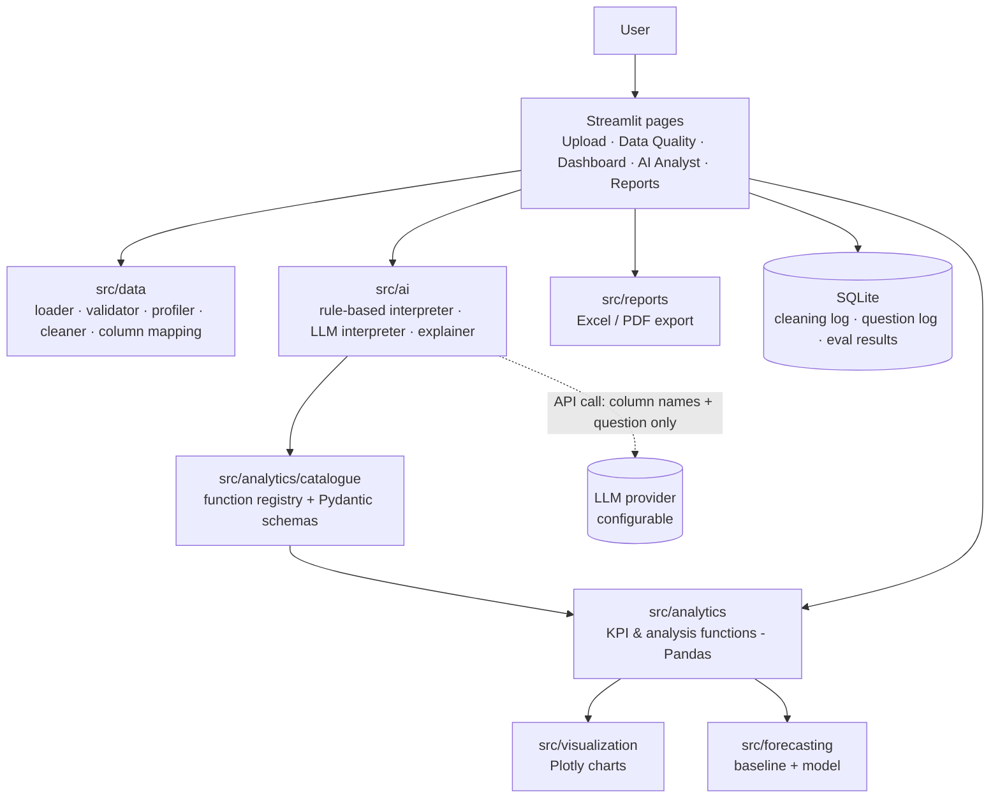
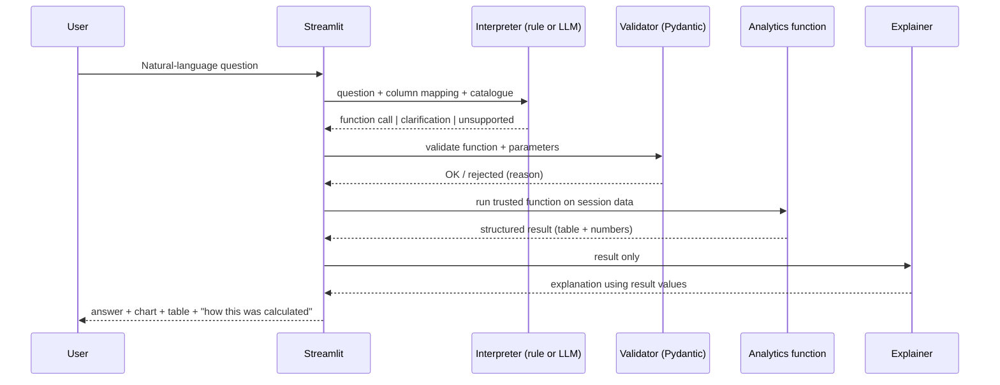

# Phase 1 — Proposal and Planning

**Project:** AI-Powered Business Data Analyst
**Stage:** Phase 1 (proposal and planning). No application code is written in this phase.
**Status:** Draft for student review
**Date:** 2026-10-28

---

## 1. Refined Title Options

| # | Title | What it emphasises |
|---|-------|--------------------|
| 1 | **AI-Powered Business Data Analyst: Answering Natural-Language Business Questions over Tabular Sales Data Using Validated Analytical Functions** | The key design idea: the AI only *chooses* trusted functions; it never computes numbers itself. |
| 2 | **Grounded Conversational Analytics: An LLM-Assisted System for Verifiable Business Data Analysis in Small and Medium Enterprises** | The "grounded / verifiable" angle and the SME target user. |
| 3 | **From Question to Verified Answer: Comparing Rule-Based and LLM Tool-Calling Approaches for Natural-Language Business Analytics** | The research comparison (evaluation-focused title). |

**Recommendation: Title 1.** It keeps your original wording (so supervisors recognise it), but replaces vague words like "intelligent" with something testable ("validated analytical functions"). Title 3 is a good fallback if your supervisor wants a more research-heavy title.

> Why avoid words like "intelligent" or "automated analysis"? Examiners often ask "how do you measure intelligence?" A title that names a concrete technique is easier to defend in a viva.

---

## 2. Problem Statement

Small and medium-sized enterprises (SMEs) commonly record sales, orders, and customer transactions in spreadsheets. Turning these records into decisions — for example, "which products are declining?" — normally requires Excel formulas, SQL, Python, or BI tools such as Power BI and Tableau. Many owners and managers do not have these skills or the budget to hire an analyst.

Large language models (LLMs) appear to solve this: a user can type a question in plain English. However, LLMs are known to produce fluent but incorrect content ("hallucination"), and when asked to do arithmetic over large tables they may invent or miscalculate figures. For business decisions, a confident wrong number is worse than no answer.

There is therefore a need for a system that (a) lets non-technical users ask business questions in natural language, (b) computes every figure deterministically from the uploaded data, (c) is honest when the data cannot answer the question, and (d) exposes data-quality problems that could make the answer misleading.

---

## 3. Research Question and Objectives

### Main research question

> **How accurately and reliably can a system that restricts an LLM to selecting from a catalogue of validated analytical functions answer natural-language business questions over tabular retail data, compared with a rule-based (non-LLM) question parser?**

### Sub-questions

- **RQ1.** What proportion of benchmark questions does each approach answer with the correct numerical result, filters, and grouping?
- **RQ2.** How well does each approach recognise questions that are unsupported or need clarification, instead of returning a wrong answer?
- **RQ3.** What are the latency and (for the LLM approach) the monetary cost per successful answer?

### Objectives

1. **Data handling:** Build a module that accepts CSV and Excel (.xlsx) files, profiles them, and reports data-quality issues (missing values, duplicates, invalid dates, negative quantities, outliers) with user-approved cleaning and an audit log.
2. **KPI engine:** Implement and unit-test documented business KPI functions (revenue, orders, average order value, product/category/customer/time breakdowns) that are independent of any AI component.
3. **Natural-language interface:** Implement two interchangeable question interpreters — a rule-based baseline and an LLM tool-calling interpreter — that map questions to validated function calls, ask for clarification when needed, and decline unsupported questions.
4. **Advanced analytics and reporting:** Implement one advanced module (recommended: sales forecasting compared against a seasonal-naïve baseline) and export results to Excel and PDF reports.
5. **Evaluation:** Build a benchmark of 60–100 questions with independently verified answers and compare both interpreters on accuracy, unsupported-question handling, latency, and cost, plus a small consented usability study.

---

## 4. Research Gap and Initial Literature

### Important honesty note

The underlying technologies are **not new**. Natural-language interfaces to databases have been studied for decades, text-to-SQL is a large research field, and commercial tools (Power BI Q&A / Copilot, Tableau's AI features) already offer natural-language analytics. Your project must **not** claim to invent these. The contribution of an undergraduate capstone is a **well-engineered integration plus an honest, reproducible evaluation**.

### What the literature says (initial reading list)

> ⚠️ I am confident these sources exist, but **you must open each one (Google Scholar / publisher site) and check authors, year, venue, and page numbers before citing it.** Do not cite anything you have not read at least the abstract of. Format them later in your college's citation style.

| Theme | Source (verify before citing) | Relevance to your project |
|-------|-------------------------------|---------------------------|
| Text-to-SQL benchmark | Yu, T. et al. (2018). *Spider: A Large-Scale Human-Labeled Dataset for Complex and Cross-Domain Semantic Parsing and Text-to-SQL Task.* EMNLP 2018. | Standard benchmark; shows how NL→query accuracy is measured (exact match vs execution accuracy). |
| Realistic, "dirty" databases | Li, J. et al. (2023). *Can LLM Already Serve as a Database Interface? A BIg Bench for Large-Scale Database Grounded Text-to-SQLs (BIRD).* NeurIPS 2023 Datasets & Benchmarks. | Shows LLM accuracy drops on large, messy, real-world data — supports your focus on data quality and validation. |
| LLMs for text-to-SQL | Rajkumar, N., Li, R., & Bahdanau, D. (2022). *Evaluating the Text-to-SQL Capabilities of Large Language Models.* arXiv:2204.00498. | Early evaluation of LLMs on text-to-SQL. |
| LLMs for text-to-SQL | Gao, D. et al. (2024). *Text-to-SQL Empowered by Large Language Models: A Benchmark Evaluation.* Proceedings of the VLDB Endowment, 17(5). | Prompt-engineering comparison; useful for your methodology chapter. |
| Tool use by LLMs | Schick, T. et al. (2023). *Toolformer: Language Models Can Teach Themselves to Use Tools.* NeurIPS 2023. | Academic basis for "LLM calls external tools rather than computing itself". |
| Hallucination | Ji, Z. et al. (2023). *Survey of Hallucination in Natural Language Generation.* ACM Computing Surveys, 55(12). | Justifies why the LLM must not produce numbers. |
| NL interfaces for visualisation | Shen, L. et al. (2023). *Towards Natural Language Interfaces for Data Visualization: A Survey.* IEEE TVCG, 29(6). | Related work on NL → chart systems. |
| LLM-generated visualisation | Dibia, V. (2023). *LIDA: A Tool for Automatic Generation of Grammar-Agnostic Visualizations and Infographics using Large Language Models.* ACL 2023 (System Demonstrations). | Contrast: LIDA lets the LLM generate code; your design deliberately does not. |
| The dataset itself | Chen, D., Sain, S. L., & Guo, K. (2012). *Data mining for the online retail industry: A case study of RFM model-based customer segmentation using data mining.* Journal of Database Marketing & Customer Strategy Management, 19(3), 197–208. | Original paper behind the UCI Online Retail dataset. |
| Forecasting baselines | Hyndman, R. J., & Athanasopoulos, G. (2021). *Forecasting: Principles and Practice* (3rd ed.). OTexts. (free online) | Naïve / seasonal-naïve baselines, MAE, MASE. |
| Anomaly detection | Liu, F. T., Ting, K. M., & Zhou, Z.-H. (2008). *Isolation Forest.* IEEE ICDM 2008. | Only if you choose the anomaly module. |
| Data quality | Wang, R. Y., & Strong, D. M. (1996). *Beyond Accuracy: What Data Quality Means to Data Consumers.* Journal of Management Information Systems, 12(4). | Framework for your data-quality dimensions. |
| Usability | Brooke, J. (1996). *SUS: A "quick and dirty" usability scale.* In *Usability Evaluation in Industry*. Taylor & Francis. | Standard questionnaire for your user study. |
| Commercial tools | Microsoft Power BI Q&A / Copilot documentation; Tableau release notes (Ask Data was retired in 2024 in favour of newer AI features — confirm on Tableau's site). | Grey literature: describes existing practice. Cite official docs, not blogs. |

### Proposed research gap (realistic wording)

1. **Most published text-to-SQL work measures accuracy on benchmark databases**, not on single spreadsheet uploads typical of SMEs, and usually does not report how often a system *correctly refuses* unanswerable questions.
2. **Systems that let an LLM generate code or SQL** (e.g. LIDA-style approaches) gain flexibility but make it harder to guarantee that figures are correct and safe to run. **Less attention has been paid, at small scale, to the trade-off of a restricted function-catalogue design** — narrower coverage, but every number traceable to a tested function.
3. **Commercial tools are closed-source**, so their accuracy on a given dataset cannot be independently measured or reproduced.

**Your contribution:** an open, reproducible prototype and a controlled comparison (rule-based vs LLM tool-calling over the *same* validated function catalogue) on a public retail dataset, reporting accuracy, refusal behaviour, latency, and cost — including data-quality effects.

> Use cautious phrases like "limited attention" or "few small-scale reproducible evaluations" rather than "no research has been done". You cannot prove a negative, and examiners know this.

---

## 5. Requirements

Priority uses MoSCoW: **M**ust, **S**hould, **C**ould, **W**on't (this version).

### 5.1 Functional requirements

| ID | Requirement | Priority |
|----|-------------|----------|
| FR-01 | Upload CSV and .xlsx files; reject other types (.xls, .xlsm with macros, scripts). | M |
| FR-02 | Enforce a maximum file size (proposed 50 MB) and row limit, with clear error messages. | M |
| FR-03 | Show preview, row/column counts, column names and inferred data types. | M |
| FR-04 | Column mapping: user confirms which columns are date, product, quantity, unit price, customer, invoice, etc. Auto-suggest for known datasets. | M |
| FR-05 | Profile data: missing values, duplicates, type mismatches, invalid dates, negative/zero values, numeric summaries, category frequencies, outlier flags. | M |
| FR-06 | Propose cleaning steps; user approves each; original data preserved; cleaning log recorded. | M |
| FR-07 | Calculate KPIs: total revenue, distinct orders, average order value, sales by product/category/period, top/bottom N, customer summaries. | M |
| FR-08 | Gross profit only when a valid cost column is mapped; otherwise state it cannot be calculated. | M |
| FR-09 | Handle cancellations/returns explicitly (e.g. invoices starting with "C" in the UCI data) with a user-visible rule. | M |
| FR-10 | Dashboard with KPI cards, trend charts, product/category charts, date and category filters. | M |
| FR-11 | Natural-language question box; system maps question to a catalogue function and shows the result, chart, explanation, and the exact operation/filters used. | M |
| FR-12 | Ask for clarification when a question is ambiguous (e.g. "best product" — by revenue or quantity?). | M |
| FR-13 | Decline unsupported questions with an explanation (e.g. "profit" when no cost column exists). | M |
| FR-14 | Selectable interpreter: rule-based (no API, no cost) or LLM. Core analytics must work with no API key. | M |
| FR-15 | One advanced module (recommended: sales forecast with baseline comparison and error metrics). | M |
| FR-16 | Export Excel report (profile, quality, KPIs, results, cleaning log). | M |
| FR-17 | Export PDF summary report with charts, findings, assumptions, limitations, analysis date. | S |
| FR-18 | Log questions, chosen operations, success/failure, and latency for evaluation (no raw data values). | S |
| FR-19 | Validated read-only SQL as a second execution path. | C |
| FR-20 | Second advanced module (anomaly detection or RFM segmentation). | C |
| FR-21 | User accounts, multi-user persistence, arbitrary dataset formats, LLM-generated Python execution. | W |

### 5.2 Non-functional requirements

| ID | Category | Requirement (targets — to be measured, not assumed) |
|----|----------|-----------------------------------------------------|
| NFR-01 | Correctness | KPI functions pass unit tests against hand-verified examples; identical input always gives identical output. |
| NFR-02 | Traceability | Every displayed number links to the function name, parameters, and filters that produced it. |
| NFR-03 | Performance | Target: dashboard loads within ~5 s for ~500k rows on a typical student laptop; rule-based answers < 1 s; LLM answers median < 6 s. |
| NFR-04 | Security | No secrets in code (`.env` only); no execution of uploaded content or LLM-generated code; parameters validated with Pydantic; SQL (if added) read-only with timeout and row limit. |
| NFR-05 | Privacy | Datasets kept in the user's session only; not written to logs; only column names and metadata (not row values) sent to the LLM by default. |
| NFR-06 | Session isolation | One user's data is never visible in another session. |
| NFR-07 | Reliability | Malformed files and failed API calls produce friendly messages, never a crash or stack trace. |
| NFR-08 | Usability | Non-technical users can complete core tasks without training; target SUS ≥ 68 (the commonly cited average), reported honestly whatever the result. |
| NFR-09 | Maintainability | Modular code, type hints, docstrings; ≥ 80% test coverage for `src/analytics` and `src/data`. |
| NFR-10 | Cost | LLM cost per question logged; a hard monthly budget/spending limit set on the API account. |
| NFR-11 | Portability | Runs locally on Windows/macOS/Linux with Python 3.11+ via `requirements.txt`. |

---

## 6. Dataset Comparison

| Dataset | Size / period | Key columns | Strengths | Weaknesses | Licence |
|---------|---------------|-------------|-----------|------------|---------|
| **UCI Online Retail** (id 352) | ~541,909 rows; Dec 2010 – Dec 2011; UK online gift retailer | InvoiceNo, StockCode, Description, Quantity, InvoiceDate, UnitPrice, CustomerID, Country | Real transactions; well-known; has published paper; realistic data-quality issues (cancellations "C…", ~25% missing CustomerID, negative quantities, zero prices, non-product codes like POST/M) | Only ~13 months (weak for yearly seasonality); **no category, no cost → no profit** | CC BY 4.0 |
| **UCI Online Retail II** (id 502) | ~1,067,371 rows; Dec 2009 – Dec 2011; same retailer | Invoice, StockCode, Description, Quantity, InvoiceDate, Price, Customer ID, Country | ~2 years of history → better for forecasting and year-over-year questions; same issue types | Larger (slower Excel loading); two sheets to combine; still no category or cost | CC BY 4.0 |
| **"Sample Superstore"** (Tableau sample, many Kaggle copies) | ~10k rows; 4 years | Order ID, Order Date, Customer, Segment, Region, Category, Sub-Category, Sales, Quantity, Discount, Profit | Has **category and profit** → tests the profit path and column mapping | Synthetic/demo data; licence of Kaggle copies unclear; already-aggregated "Sales" (no unit price) | Check source |
| **Olist Brazilian E-commerce** (Kaggle) | ~100k orders; 2016–2018 | Multiple related tables (orders, items, products, customers, reviews) | Rich, relational; good for SQL later | Requires joins → too complex for v1 single-file upload | CC BY-NC-SA 4.0 |
| **Own synthetic test file** | 20–200 rows | Designed by you | Answers can be verified by hand → ideal for unit tests and part of the benchmark | Not realistic | Yours |

> **Note:** these row counts and column names are from the UCI documentation as I know it. In Phase 2 we will download the actual files and **confirm the schema ourselves** before relying on it.

**Recommendation:**
- **Primary:** UCI Online Retail II (2 years of data supports forecasting). If loading speed is a problem on your laptop, fall back to the original Online Retail.
- **Secondary (column-mapping & profit test):** Sample Superstore, only if you can find a copy with a clear licence.
- **Unit tests:** a small hand-built synthetic dataset.

**Important business caveat:** neither UCI dataset contains product categories or costs. So questions about "categories" and "profit" must either be declined honestly, or answered using a clearly documented proxy (e.g. a manually defined category mapping) — this is itself a good example of FR-08/FR-13 in your report.

---

## 7. Proposed System Architecture

### 7.1 Big picture (simple explanation)

Think of the system like a restaurant:
- **Streamlit pages** are the dining room (what the user sees).
- **The AI interpreter** is the waiter: it understands the order ("which product made the most money?") and writes it on a ticket in a fixed format.
- **The validator** checks the ticket is a real menu item with valid options.
- **The analytics functions** are the kitchen: they do the actual cooking (calculations) using tested recipes.
- **The explanation step** describes the dish using only what came out of the kitchen.

The waiter never cooks. That is the core safety rule: **the LLM chooses; Python calculates.**

### 7.2 What "tool calling" looks like (tiny example)

User asks: *"Which product generated the highest revenue in 2011?"*

The interpreter (rule-based or LLM) must output a structured request like:

```json
{
  "function": "top_n_by_metric",
  "params": {"metric": "revenue", "group_by": "product", "n": 1,
             "date_from": "2011-01-01", "date_to": "2011-12-31"}
}
```

Our code checks it against a Pydantic schema, runs the trusted Pandas function, and gets e.g. `{"product": "...", "revenue": 12345.67}`. Only then is an explanation written — from those numbers.

### 7.3 Component diagram



### 7.4 Question-answering flow



### 7.5 Folder structure (adjusted from your brief)

```
app.py                      Streamlit entry point
pages/                      1_Upload, 2_Data_Quality, 3_Dashboard, 4_AI_Analyst, 5_Reports
src/data/                   loader.py, validation.py, profiling.py, cleaning.py, mapping.py
src/analytics/              kpis.py, breakdowns.py, catalogue.py (registry + schemas)
src/ai/                     rule_interpreter.py, llm_interpreter.py, llm_client.py, explainer.py
src/visualization/          charts.py
src/forecasting/            baselines.py, model.py, evaluation.py
src/database/               store.py (SQLite)
src/reports/                excel_report.py, pdf_report.py
tests/                      unit/, integration/, evaluation/ (benchmark questions + runner)
data/                       raw/ (git-ignored), sample/ (small synthetic file, committed)
docs/                       proposal, methodology, diagrams, results, project_log.md
```

### 7.6 Key architectural decisions (and why)

| Decision | Reason |
|----------|--------|
| **No FastAPI at first** | Streamlit can call Python functions directly. A separate API adds deployment and debugging work without benefit until another client (e.g. mobile) needs it. Revisit in Phase 8 only if required. |
| **SQLite, not PostgreSQL** | Zero setup, a single file, perfect for logs and evaluation results. PostgreSQL only if you deploy for multiple concurrent users. |
| **Data in session memory, not the database** | Simplest way to guarantee session isolation and privacy. |
| **Two interpreters sharing one function catalogue** | Gives you the research comparison *and* a free, offline fallback. The comparison is fair because both call exactly the same functions. |
| **LLM receives column names + metadata, not rows** | Reduces cost, protects privacy, and prevents the LLM "reading" numbers it could misreport. |
| **Provider-agnostic `llm_client.py`** | One small wrapper class so switching providers changes one file, avoiding lock-in. No LangChain needed. |
| **No LLM-generated code execution** | Eliminates a major security and correctness risk; documented as a deliberate limitation. |

---

## 8. 12-Week Development Timeline

Assumes ~12–15 hours/week. Adjust to your semester dates.

| Week | Phase | Main work | Deliverable / checkpoint |
|------|-------|-----------|--------------------------|
| 1 | 1 – Planning | Finalise title, RQ, scope; read core papers; set up Git/GitHub, Python env | Approved proposal; repo skeleton |
| 2 | 2 – Data exploration | Download dataset; verify schema; EDA notebook; document columns & quality issues | Data dictionary; EDA findings; KPI definitions doc |
| 3 | 3 – Analytics engine | KPI functions + synthetic test data + unit tests | `src/analytics` with passing tests |
| 4 | 3/4 | Breakdown/ranking/time-series functions; function catalogue with Pydantic schemas; start upload page | Catalogue v1; upload + preview |
| 5 | 4 – App | Profiling, cleaning with approval & log, column mapping | Data Quality page |
| 6 | 4 – App | Dashboard: KPI cards, charts, filters | Working dashboard — **mid-project demo to supervisor** |
| 7 | 5 – AI | Rule-based interpreter; clarification & unsupported handling; draft benchmark questions | Offline NL answering works |
| 8 | 5 – AI | LLM tool-calling interpreter; explainer; question logging; cost tracking | Both interpreters selectable |
| 9 | 6 – Advanced | Forecasting: chronological split, seasonal-naïve baseline, model, MAE/MASE | Forecast page + evaluation table |
| 10 | 7 – Evaluation | Finalise 60–100-question benchmark with verified answers; run both interpreters; error analysis; reports export | Results tables; Excel/PDF export |
| 11 | 7/8 | Usability sessions (with consent); bug fixes; README; deployment or reproducible local setup | SUS results; deployed demo or install guide |
| 12 | 8 – Docs | Final report, presentation, demo script, viva preparation | Submission |

**Buffer:** if you fall behind, cut in this order: PDF export → validated SQL → second advanced module. Never cut the evaluation.

---

## 9. Risks and Mitigation

| # | Risk | Likelihood | Impact | Mitigation |
|---|------|-----------|--------|------------|
| R1 | LLM returns wrong function or parameters | High | High | Pydantic validation; clarification step; benchmark measures it; rule-based fallback. |
| R2 | LLM invents numbers in the explanation | Medium | High | Explainer receives only the result; automated check that every number in the text appears in the result; option to use a template explanation instead. |
| R3 | API costs or no API access | Medium | Medium | Core app works without API; set spending limit; cache repeat questions; option of a free local model (e.g. via Ollama) if your laptop can run it — slower and possibly less accurate. |
| R4 | Dataset lacks needed fields (category, cost) | Certain | Medium | Decline honestly; document; optional secondary dataset for profit path. |
| R5 | Data-quality traps (cancellations, missing customers, duplicates) give wrong KPIs | High | High | Explicit, documented business rules; tests with hand-made edge cases; show rule in the UI. |
| R6 | Performance on ~1M rows | Medium | Medium | Load once and cache per session; convert dtypes; use original smaller dataset if needed; sample for heavy charts (stated on chart). |
| R7 | Scope creep (too many features) | High | High | MoSCoW list; one advanced module only; phase approvals. |
| R8 | Benchmark answers wrong or biased toward own system | Medium | High | Compute expected answers independently (Excel pivot or hand SQL), not with the app's own functions; write questions before tuning the interpreters; keep a held-out subset. |
| R9 | Fabricated/incorrect citations | Low (if careful) | High | Verify every source; cite only what you have read. |
| R10 | Ethics/consent for user testing | Medium | Medium | Check college ethics process early (week 1–2); consent form; anonymous responses. |
| R11 | Sending business data to a third-party API | Medium | High | Send metadata only; make LLM mode opt-in; state this in the UI and report. |
| R12 | Losing work | Low | High | Commit to GitHub frequently; small commits per feature. |

---

## 10. Decisions You Need to Make Before Phase 2

1. **Title:** choose option 1, 2, or 3 (or a variant).
2. **Citation style** required by your college (APA 7, IEEE, Harvard, …).
3. **Primary dataset:** Online Retail II (recommended) or original Online Retail.
4. **Advanced module:** Forecasting (recommended — it has a clear baseline and standard error metrics), anomaly detection (hard to evaluate: no true labels), or RFM segmentation (natural for this dataset but "usefulness" is harder to measure objectively).
5. **LLM access:** do you have, or can you pay for, an API key? Which provider does your college allow? Or do you prefer a local model? (No API is needed until Phase 5.)
6. **Semester dates & weekly hours**, so the timeline can be pinned to real weeks.
7. **Supervisor requirements:** mandatory chapters, page limits, whether a deployed demo is required.
8. **Ethics:** does your college require approval for a small usability study?
9. **Repository visibility:** public portfolio repo or private until submission?
